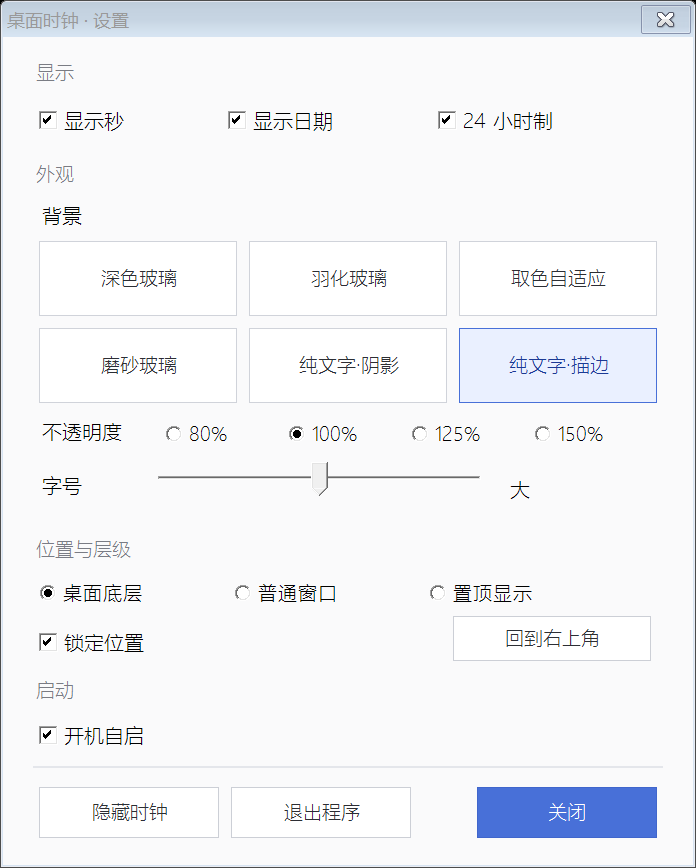
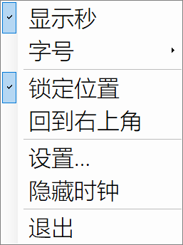

# DeskClock · 桌面时钟

一个 Windows 桌面时间挂件。无边框、逐像素透明，可以「钉」在桌面底层——平时一直在，切到浏览器、游戏、终端时被窗口自然遮挡，不会浮在最前面挡事。

托盘图标负责随时叫出设置，不占桌面空间。





## 特性

- **逐像素透明**：`UpdateLayeredWindow` + 32bpp 预乘 alpha。不是「抠透明色」，文字边缘没有黑边，圆角和羽化都平滑。
- **6 种背景**：深色玻璃 / 羽化玻璃 / 取色自适应 / 磨砂玻璃 / 纯文字·阴影 / 纯文字·描边
- **4 档不透明度**：80% / 100% / 125% / 150%
- **5 档字号**：版面按「最宽字形」测量，秒数跳变时窗口尺寸不抖，秒数右对齐
- **3 种显示层级**：桌面底层 / 普通窗口 / 置顶显示
- **系统托盘**：左键打开设置，右键弹出快捷菜单；explorer 重启后自动重新注册图标
- **完整设置窗口**：显示项、背景、不透明度、字号、层级、锁定、开机自启集中管理
- **DPI 感知**：150% 缩放下文字依然锐利
- 主窗口单实例运行、不占任务栏、不进 Alt+Tab
- 菜单与设置窗口用对号/勾选标出当前状态，修改即时保存
- 整个程序是单文件 C#，只依赖 .NET Framework 自带的 `System.Drawing` / `System.Windows.Forms`，无任何第三方库

## 运行

双击 `DeskClock.exe`，需要 .NET Framework 4.x（Windows 10 / 11 自带）。

首次运行出现在屏幕右上角，按住左键拖动即可移动。托盘区会出现一个时钟图标。

## 使用

| 操作 | 说明 |
| --- | --- |
| 左键拖动时钟 | 移动位置（勾选「锁定位置」后不可拖动） |
| 右键时钟 | 打开快捷菜单 |
| 鼠标滚轮 | 快速切换字号 |
| 左键托盘图标 | 打开设置窗口 |
| 右键托盘图标 | 打开同一套快捷菜单 |

快捷菜单：显示秒 / 字号 / 锁定位置 / 回到右上角 / 设置… / 隐藏时钟 / 退出

设置窗口：显示秒、显示日期、24 小时制、背景、不透明度、字号、显示层级、锁定位置、回到右上角、开机自启、隐藏时钟、退出程序。

隐藏只对本次运行有效；重启程序会恢复显示，避免下次开机后找不到时钟。

## 显示层级

| 选项 | 行为 |
| --- | --- |
| 桌面底层（默认） | 一直显示，但永远压在其它窗口下面。切到浏览器、游戏时被遮住，回到桌面又露出来；也不会被 Wallpaper Engine 的动态壁纸盖住 |
| 普通窗口 | 和别的窗口平级，点了会浮到前面 |
| 置顶显示 | 永远在最前 |

「桌面底层」的实现方式，是把窗口插到 **最靠前的 `Progman` / `WorkerW` 窗口之上、所有应用窗口之下** 的那一格。直接用 `HWND_BOTTOM` 会被壁纸层盖住，所以没有用裸沉底。

## 开机自启

勾选后在「启动」文件夹创建快捷方式，指向当前 exe。启动时只在快捷方式目标**已不存在**时自动改写，目标仍存在就绝不改动——不会因为运行了另一份副本而劫持原来的自启项。

设置里的勾只表示「当前这份 exe 是自启目标」。

## 编译

```bat
build.bat
```

或者手动：

```bat
csc /nologo /codepage:65001 /target:winexe /out:DeskClock.exe ^
    /r:System.dll /r:System.Drawing.dll /r:System.Windows.Forms.dll DeskClock.cs
```

## 文件

| 文件 | 说明 |
| --- | --- |
| `DeskClock.cs` | 全部源码（单文件） |
| `DeskClock.exe` | 已编译好的程序 |
| `使用说明.txt` | 更详细的中文说明 |
| `预览-设置.png` | 设置窗口实际渲染 |
| `预览-菜单.png` | 快捷菜单实际渲染 |
| `预览-字号.png` | 字号子菜单 |
| `预览-背景对比.png` | 六种背景样式对比 |

## 已知限制

- **3 号「取色自适应」与 4 号「磨砂玻璃」需要抓屏**：组件会先把自身隐藏，再截取卡片所在区域并模糊。若抓屏被系统或安全软件拦截，会自动回退成 1 号深色玻璃，不会报错崩溃。
- 壁纸是动态的（Wallpaper Engine）时，4 号的模糊是抓屏那一刻的**定格**；壁纸动画仍在跑，但卡片里的模糊不会跟着动。这种场景建议用 2 号羽化玻璃。
- 抓屏是否可用可以自检：运行 `DeskClock.exe --selftest`，看 `selftest.txt` 里的「抓屏可用」一行。
- 设置窗口是普通窗口，会出现在任务栏；主时钟窗口仍然不占任务栏。

## 自检 / 排查

| 命令 | 产物 |
| --- | --- |
| `DeskClock.exe --selftest` | `selftest.txt`：DPI、表面尺寸、字体、分层窗口推送、背景、抓屏是否可用、前台窗口类 |
| `DeskClock.exe --vistest` | `vistest.txt`：隐藏 / 重新显示的实际效果 |
| `DeskClock.exe --ztest` | `ztest.txt`：逐层列出窗口 z 序，验证是否真的在桌面层之上、应用窗口之下 |
| `DeskClock.exe --bg 3` | 用指定背景样式启动（0–5），方便对比 |
| `DeskClock.exe --preview --wall <图片> --out <目录>` | 生成六种背景的对比预览图 |
| `DeskClock.exe --menushot` | 生成菜单实际渲染图 |
| `DeskClock.exe --settingsshot` | 生成设置窗口实际渲染图 |

## 设置文件

`%APPDATA%\DeskClock\settings.ini`，修改后自动保存。

键：`seconds` `date` `hour24` `bg` `bgopacity` `size` `zorder` `locked` `x` `y`

## 技术备注

- 主窗口用 `WS_EX_LAYERED | WS_EX_TOOLWINDOW`，配合 `UpdateLayeredWindow` 推送 32bpp DIB，实现真正的逐像素透明。
- 桌面底层模式监听 `WM_WINDOWPOSCHANGED`，一旦 z 序被改动就重新摆位，另有约 1 秒一次的兜底校正。
- 托盘使用 `NotifyIcon`，并监听 `TaskbarCreated` 消息，explorer 重启后自动恢复图标。
- 托盘 `HICON` 生成后立即克隆并释放原句柄，避免退出时残留幽灵图标或重复释放。
- GDI+ 写入 DIB 时像素已是预乘 alpha，所以 `BLENDFUNCTION` 用 `alphaFmt = 1`、`flags = 0`。